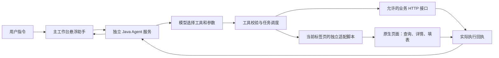

# BCT 工作台 Agent 开发经验与 Skill

将既有 BCT 收益互换系统接入悬浮 Agent 的开发经验整理为可复用 Skill。整理基线：2026-11-06。

## 这套方案解决什么

用户在任意工作台页面输入指令，Agent 可以选择已适配的能力，打开业务页面、填写查询条件、触发原生查询，或打开原生表单填入已知要素。



AI 负责理解意图、组合条件、选择工具并根据结果继续处理；代码负责认证、参数约束、实际操作和结果核对。Skill 提供工作方法和业务约定，不会凭空增加工具能力。

## 已沉淀的能力与经验

| 范围 | 处理方式 |
| --- | --- |
| 合约查询 | 状态、编号与多种日期条件组合；页面实际填入，再核对请求条件 |
| 合约详情 | 精确定位原记录，打开原生详情抽屉 |
| 收益互换簿记 | 在列表的原生“创建一般合约”弹窗填写已知字段，用户最终确认 |
| 标的物管理 | 查询，以及原生新增/编辑表单填写 |
| 交易对手、机构 | 查询、查看，以及已适配基础资料的新增/编辑填写 |
| 页面保护 | 区分只读详情、人工编辑、本任务表单、联动加载与人工保存声明 |
| 发布维护 | 原业务构建包保持不变；入口加载独立脚本，配套验证与回滚 |

这些能力属于已有 `spring-ai-starter` 项目。本仓库提供总结与开发 Skill，不包含该服务、原系统构建包或生产配置。移植到其他版本时必须重新核对字段和页面行为。

## Skill 入口

[skills/bct-workbench-agent/SKILL.md](skills/bct-workbench-agent/SKILL.md)

| 文件 | 用途 |
| --- | --- |
| [architecture.md](skills/bct-workbench-agent/references/architecture.md) | Agent、Skill、工具、执行器和当前用户身份的关系 |
| [page-adaptation.md](skills/bct-workbench-agent/references/page-adaptation.md) | 原生页面适配、弹窗生命周期、保存状态与故障处理 |
| [business-mapping.md](skills/bct-workbench-agent/references/business-mapping.md) | 合约与基础资料能力映射、单位和日期语义 |
| [verification-and-delivery.md](skills/bct-workbench-agent/references/verification-and-delivery.md) | 实现文件索引、验收与部署步骤 |

将整个 `skills/bct-workbench-agent` 文件夹放入个人 Skill 目录（通常为 `~/.codex/skills/`，自定义环境使用 `$CODEX_HOME/skills/`）。使用示例：

```text
使用 $bct-workbench-agent，为现有工作台增加合约查询条件。
先核对前端和 OpenAPI，只修改独立适配脚本，并验证页面实际查询条件。
```

```text
使用 $bct-workbench-agent，排查用户保存后仍被助手阻止切页的问题。
区分实时页面状态、助手是否提交、人工保存声明和后台保存证据。
```

仓库采用脱敏示例；不存放凭据、真实交易记录、截图或内部接口文档副本。
